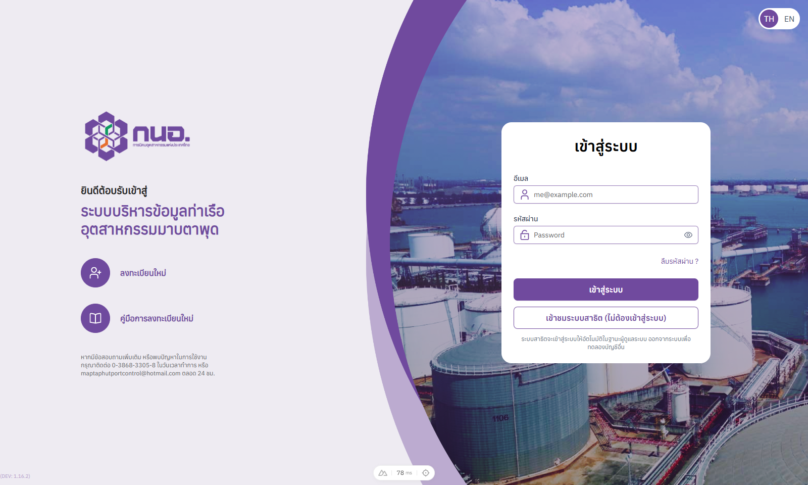
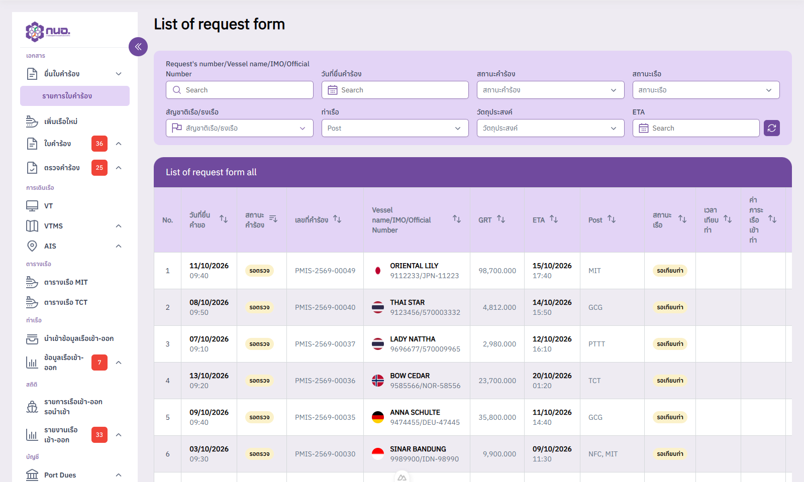

# Port Management Information System (PMIS) Upgrade

<p align="center">
  <a href="screenshots/login.png" target="_blank"></a>
  <a href="screenshots/dashboard.png" target="_blank"></a>
</p>

Full-stack system for the Map Ta Phut Industrial Port: vessel agencies file berth requests online, port officers review, approve and confirm berths, the VTMS desk logs arrivals and departures, the statistics desk reconciles vessel in-out reports, and port dues are invoiced from the approved requests. Thai/English UI, PDF and Excel reports, AIS map.

- **Frontend** (`frontend/`): Nuxt 3, Vue 3, TypeScript, Pinia, Nuxt UI + Tailwind, Leaflet, Chart.js, jsPDF.
- **Backend** (`backend/`): Node.js, Express 5, TypeScript, PostgreSQL, JWT (access + rotating refresh tokens), REST **and** GraphQL (Altair explorer), Zod, Pino, Cloudflare R2 for uploads.

**Demo:** opening the site signs the visitor in automatically as the demo account (no login page), straight to the request-form dashboard. Log out to log in or register normally; every new tab starts the demo again.

## Quick start

```bash
# 1. Database + API  (PostgreSQL 17 in Docker on 127.0.0.1:5435, API on http://localhost:4100)
cd backend
cp .env.example .env         # set PASSWORD_PEPPER and TOKEN_SECRET (32+ characters)
docker compose up -d
npm install
npm run setup                # migrations + all mock data (npm run seed reloads it any time)
npm run dev

# 2. Web app  (http://localhost:3000)
cd ../frontend
npm install
npm run dev
```

| Where | What |
| --- | --- |
| `http://localhost:3000` | Web app (auto demo login) |
| `http://localhost:4100/api/v1` | REST API |
| `http://localhost:4100/graphql` | GraphQL API (same JWT) |
| `http://localhost:4100/altair/` | Altair GraphQL explorer, pre-authenticated with the demo token and sample queries |
| `http://localhost:4100/docs/` | OpenAPI reference |

## Seeded accounts

All data is mock data created by `npm run seed` (master data, 24 accounts, 78 vessels, 66 request forms in every status, VTMS log books and anchor drops, vessel in-out reports, invoices, contracts, surveys, AIS positions).

| Account | Password | Role |
| --- | --- | --- |
| `demo@pmis.local` | `Demo@12345678` | Demo (SuperAdmin), used by the automatic login |
| `admin@pmis.local` | `Admin@12345678` | SuperAdmin |
| `reviewer@pmis.local` / `approver@pmis.local` | `Officer@12345678` | Request reviewer / approver |
| `mit@pmis.local` / `tct@pmis.local` / `spacial@pmis.local` | `Officer@12345678` | Berth officers |
| `stat@pmis.local` / `statapprove@pmis.local` | `Officer@12345678` | Statistics officer / head |
| `vtms@pmis.local` | `Officer@12345678` | VTMS officer |
| `agency@pmis.local` (+12 more) | `Agency@12345678` | Vessel agencies |

These passwords are for local development. In production (`ENV=production` or `NODE_ENV=production`) the seed requires your own `ADMIN_PASSWORD`, the officer and agency accounts get random passwords, and the demo account is read-only unless `DEMO_READ_ONLY=false`; see `backend/README.md`.

## Backend flow

```
Browser (Nuxt)                         API (Express)                              PostgreSQL
──────────────                         ─────────────                              ──────────
open tab ──► POST /auth/demo ─────────► sign demo user, issue access (1h) + refresh (7d) ─► refresh_tokens
             store tokens in localStorage
every call ──► Authorization: Bearer ─► verifyAuthToken (JWT + live session) ─► requirePermission (role codes)
401 expired ─► POST /auth/refresh ────► rotate refresh token (reuse ⇒ family revoked)
logout ──────► POST /auth/logout ─────► revoke this session only

routes ──► controllers (Zod validation, {data}/{error} envelope) ──► services (workflow rules) ──► repositories (SQL)
GraphQL /graphql ─► resolvers call the same services
uploads ─► multer ─► storage driver (local ./uploads or Cloudflare R2) ─► files + link tables
```

Request-form workflow implemented by the services: `Draft → PendingReview (reviewer) → PendingApproval (approver) → PendingConfirmation → PendingConfirmation1/2 (each berth office confirms its berths, special berths pick a jetty) → Approved`, with send-back (`PendingEdit` + note, previous version kept for the side-by-side review), recall and cancel. An approval registers a new vessel, a VTMS arrival marks the vessel berthed, and a berthed vessel becomes a pending port-due invoice (rate × GRT + 7% VAT).

## Cloudflare R2

Uploaded files (registration papers, vessel certificates, request attachments, contracts, vessel in-out reports, flag images) go through one storage driver. Set `STORAGE_DRIVER=r2` and fill the `R2_*` placeholders in `backend/.env` to store them in an R2 bucket; the default keeps them under `backend/uploads`. See `backend/README.md`.

## Repository layout

```
frontend/   Nuxt 3 web app (pages, components, stores, core/services = API clients)
backend/    Express + GraphQL API, migrations, seed, OpenAPI docs
screenshots/
```
